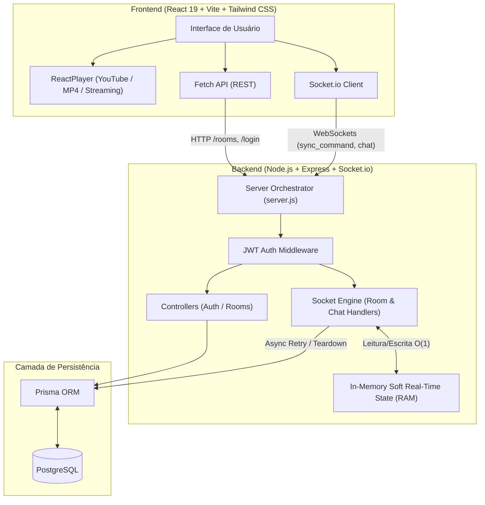
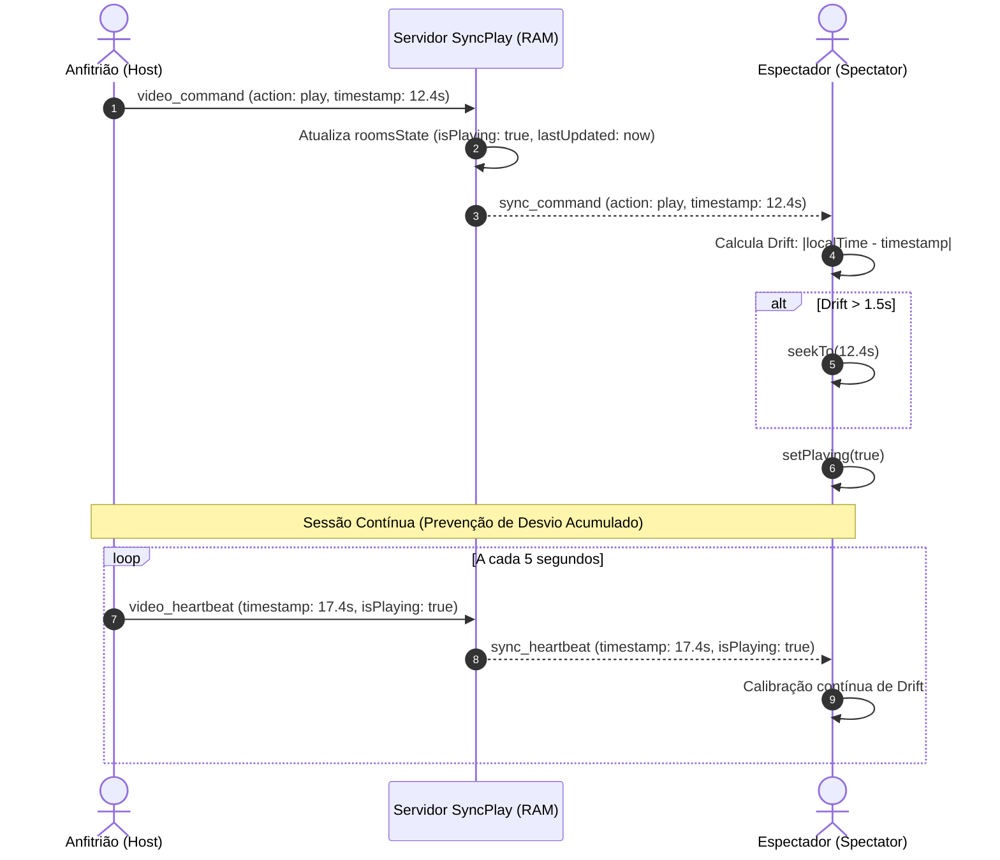
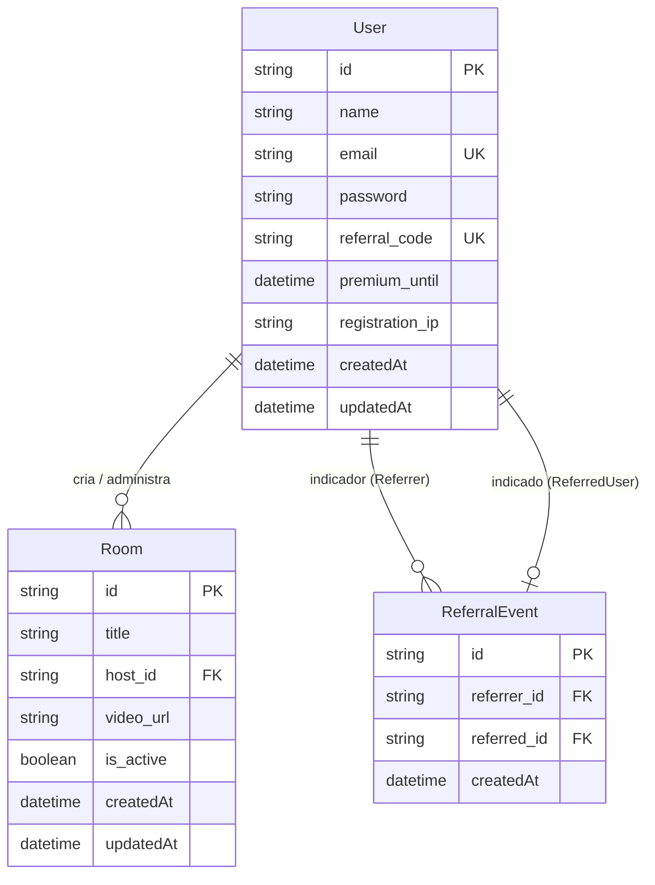

# SyncPlay Core

SyncPlay é uma aplicação web de Watch Party (consumo sincronizado de vídeo) com arquitetura Soft Real-Time e chat integrado em tempo real.

Este repositório é um monorepo contendo o frontend e o backend da aplicação.

## Estrutura do Projeto

```text
syncplay-core/
├── docker-compose.yml          # Container PostgreSQL para inicialização imediata
├── backend/
│   ├── prisma/
│   │   └── schema.prisma       # Modelagem relacional do banco (User, Room, ReferralEvent)
│   ├── src/
│   │   ├── config/             # Configurações (Prisma singleton, constantes de ambiente)
│   │   ├── controllers/        # Controladores REST (Auth, Room CRUD)
│   │   ├── middlewares/        # Middlewares de autenticação (JWT HTTP e Socket.io)
│   │   ├── routes/             # Rotas modulares (/auth, /rooms)
│   │   ├── sockets/            # Handlers de eventos WebSocket (Room Sync, Chat Real-Time)
│   │   ├── utils/              # Funções utilitárias (Retry dead-letter, formatação de avatar)
│   │   └── server.js           # Ponto de entrada modular da API e Socket.io
│   └── test/                   # Testes automatizados unitários e de integração
└── frontend/
    └── src/
        ├── components/         # Componentes React (Room, DiscordChat, Dashboard, Views)
        └── services/           # Conexão centralizada de WebSocket e API REST
```

---

## Diagramas de Arquitetura e Engenharia de Software

### 1. Visão Geral da Arquitetura do Sistema



### 2. Ciclo de Sincronização Soft Real-Time (Drift Correction & Heartbeat)



### 3. Modelo de Entidades e Relacionamentos (ER)



---

## Configuração do Ambiente Local

### Pré-requisitos
- Node.js (v18+)
- Docker (opcional, para inicialização do PostgreSQL em 1 comando) ou PostgreSQL instalado localmente.

### 1. Banco de Dados (Via Docker Compose)

Para iniciar o PostgreSQL com todas as configurações prontas, execute na raiz:
```bash
docker compose up -d
```
*(Caso utilize PostgreSQL nativo, crie a base de dados `SyncPlay` e configure o `.env` correspondente).*

### 2. Backend

1. Navegue até a pasta do backend:
   ```bash
   cd backend
   ```
2. Instale as dependências:
   ```bash
   npm install
   ```
3. Configure as variáveis de ambiente:
   - Copie o arquivo `.env.example` para `.env`:
     ```bash
     cp .env.example .env
     ```
4. Sincronize o schema do banco de dados e gere o client Prisma:
   ```bash
   npx prisma db push
   npx prisma generate
   ```
5. *(Opcional)* Popule os dados iniciais com o usuário demonstrativo:
   ```bash
   node seed.js
   ```
6. Inicie o servidor:
   ```bash
   npm run dev
   ```

### 3. Testes Automatizados (Backend)

Execute a suíte de testes com o test runner nativo do Node.js:
```bash
cd backend
npm test
```

### 4. Frontend

1. Em um novo terminal, navegue até a pasta do frontend:
   ```bash
   cd frontend
   ```
2. Instale as dependências:
   ```bash
   npm install
   ```
3. Configure as variáveis de ambiente (opcional):
   - Copie o arquivo `.env.example` para `.env`:
     ```bash
     cp .env.example .env
     ```
4. Execute o linter e inicie a aplicação:
   ```bash
   npm run lint
   npm run dev
   ```

---

## Cronograma de Refinamento (13 Dias para Entrega)

Plano de ação estruturado em 5 blocos para preparação final e entrega acadêmica:

| Bloco | Período | Foco e Entregáveis | Status |
| :--- | :--- | :--- | :--- |
| **Bloco 1** | **Dias 1 a 3** | **Estabilização e Itens Críticos:** Flexibilização da trava de IP no cadastro, centralização de URLs via `.env`, senhas estritamente com `bcrypt` e zero avisos no linter (`oxlint`). | **Concluído** |
| **Bloco 2** | **Dias 4 a 6** | **Arquitetura e Persistência:** Modularização do backend (`routes`, `controllers`, `sockets`, `middlewares`, `utils`) e persistência relacional do CRUD de salas no PostgreSQL via Prisma. | **Concluído** |
| **Bloco 3** | **Dias 7 a 9** | **Sync Engine, Infra e Testes:** *Heartbeat* periódico de 5s para calibrar drift contínuo, `docker-compose.yml` para banco e suíte de testes automatizados com 100% de aprovação. | **Concluído** |
| **Bloco 4** | **Dias 10 a 11** | **UX e Documentação Técnica:** Tratamento elegante de bloqueio de *Autoplay* dos navegadores com modal de liberação e diagramas de arquitetura (Mermaid) no README. | **Concluído** |
| **Bloco 5** | **Dias 12 a 13** | **Code Freeze e Apresentação:** Congelamento de código, validação final de ponta a ponta, roteiro de apresentação para a banca e plano de contingência (vídeo de backup). | **Em Andamento** |


